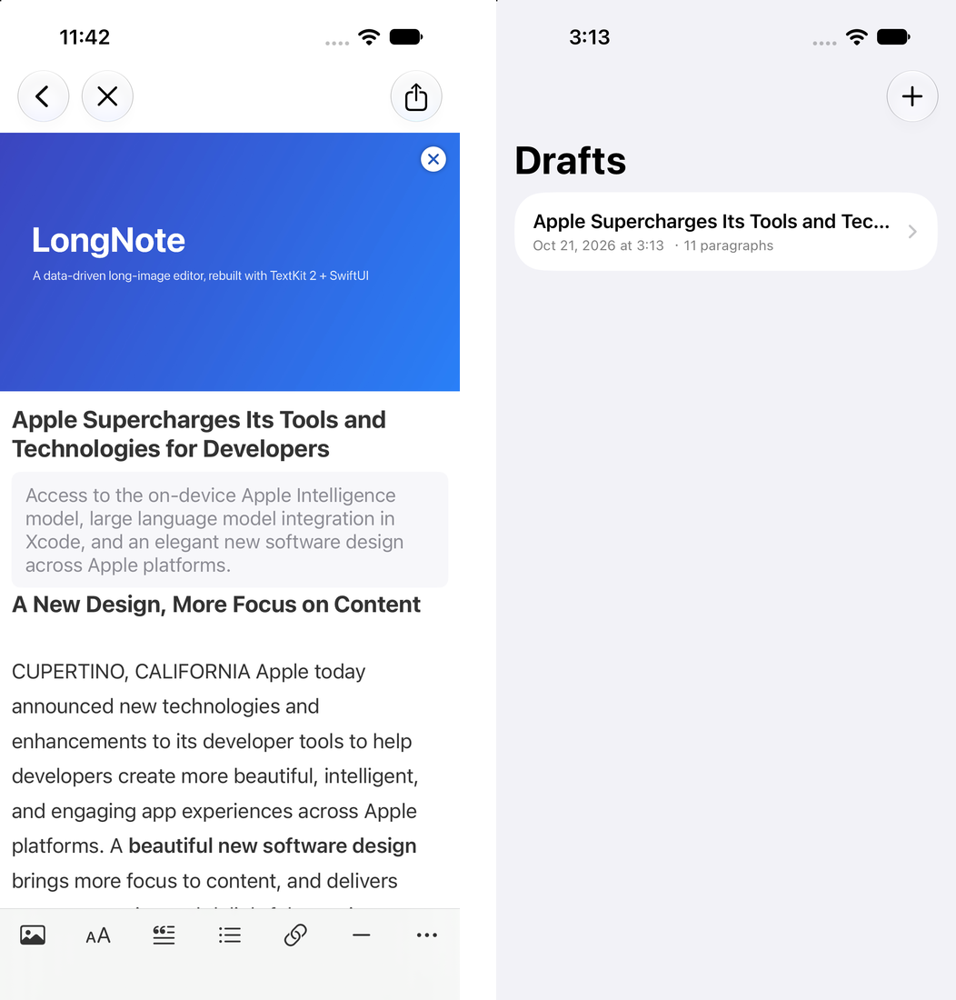

<div align="center">

# LongNote

[简体中文](README.zh-CN.md) | [English](README.md) | **日本語**

[](https://github.com/Bayonetta/LongNote/actions/workflows/ci.yml)
[](LICENSE)


</div>

LongNote は、オフラインの長文エディタを構築するための Swift Package です。Weibo の Toutiao 記事機能から派生した、かつてのスタンドアロンアプリ WeicoNote を、SwiftUI、TextKit 2 などの現代的な Apple 技術でゼロから再実装しています。



## 主な機能

- **リッチテキスト編集**：TextKit 2 を使用し、段落単位の太字、斜体、取り消し線、色、リンクに対応。
- **混在ブロック**：見出し、本文、引用、リスト、画像、区切り線を一つの文書に配置。
- **記事情報**：16:9 のカバー画像、32 文字までのタイトル、任意の概要。
- **下書きの自動保存**：ファイルベースの `ArticleStore` を使用し、記事ごとにディレクトリへ保存。入力停止から 2 秒後に保存し、SwiftData には依存しません。
- **長い画像の書き出し**：短い記事は一度に描画し、長い記事はタイルに分割して描画。
- **保存と共有**：Photos、`ShareLink`、`UIActivityViewController` に対応。
- **読みやすいリッチテキスト保存**：文字と書式を JSON として保存し、内容を確認・比較しやすい形式。

## アーキテクチャ

LongNote は、プラットフォーム非依存のコア層と iOS UI 層に分かれています。

| Target | 役割 |
|---|---|
| `LongNoteCore` | モデル、段落変換、保存、テキストスタイル |
| `LongNote` | SwiftUI エディタ、TextKit 2 ブリッジ、画像描画 |
| `LongNoteTests` | コア層のユニットテスト |

編集ルールは純粋な変換として実装しています。分割、結合、貼り付け、スタイル変換、ブロック挿入は `ParagraphMutation` で表現され、UIKit なしでテストできます。`LongNote` は `LongNoteCore` を再エクスポートするため、アプリ側は `import LongNote` だけでエディタとデータモデルを利用できます。

## 必要環境

- Xcode 16+
- Swift 6 ツールチェーン
- iOS 18+

`LongNoteCore` は Foundation のみに依存しており、モデル、段落変換ルール、保存プロトコル、ファイルストアを複数のプラットフォームで再利用できます。`LongNote` ターゲットには iOS のエディタ UI が含まれ、SwiftUI、UIKit、TextKit 2 に依存します。

## 保存構造

`FileArticleStore` は、アプリの Documents ディレクトリ内に下書きごとのディレクトリを作成します。

```text
Documents/Articles/
└── <article-uuid>/
    ├── article.json
    └── images/
        └── <file-name>
```

書式付きテキストと画像ブロックを含む文書は、例えば次のように保存されます。

```json
{
  "schemaVersion": 2,
  "id": "A1B2C3D4-...",
  "title": "Apple Supercharges Its Tools and Technologies for Developers",
  "summary": "Access to the on-device Apple Intelligence model, large language model integration in Xcode, and an elegant new software design across Apple platforms.",
  "cover": { "fileName": "cover-<uuid>.jpg", "width": 1600, "height": 900 },
  "createdAt": "2026-11-13T00:00:00Z",
  "updatedAt": "2026-11-13T00:00:00Z",
  "paragraphs": [
    {
      "id": "11111111-...",
      "kind": "title",
      "text": {
        "string": "A New Design, More Focus on Content"
      },
      "image": null,
      "isLastInList": false
    },
    {
      "id": "22222222-...",
      "kind": "body",
      "text": {
        "runs": [
          { "text": "CUPERTINO, CALIFORNIA Apple today announced new technologies and enhancements to its developer tools. A " },
          { "text": "beautiful new software design", "bold": true },
          { "text": " brings more focus to content. The " },
          { "text": "Foundation Models framework", "color": [0.16, 0.50, 0.97, 1] },
          { "text": " joins a suite of tools, and " },
          { "text": "Xcode 26", "link": "https://www.apple.com/newsroom/2025/06/apple-supercharges-its-tools-and-technologies-for-developers/" }
        ]
      },
      "image": null,
      "isLastInList": false
    },
    {
      "id": "33333333-...",
      "kind": "image",
      "text": { "string": "" },
      "image": {
        "fileName": "figure-<uuid>.jpg",
        "width": 1200,
        "height": 800,
        "caption": "Figure — the LongNote editor stack: a platform-neutral core, a TextKit 2 bridge, and a SwiftUI shell."
      },
      "isLastInList": false
    }
  ]
}
```

`article.json` には記事情報、段落構造、文字の書式、画像への参照を保存します。実際の画像データは `cover.jpg` と `images/image-01.jpg` として保存し、JSON にはファイル名とサイズだけを記録します。文字と書式を読みやすい JSON で保存するため、内容を確認・移行・比較しやすくなっています。`ArticleStore` プロトコルによりエディタと永続化方式を分離しているため、ホストアプリ側で独自のストアにも差し替えられます。

## インストール

Swift Package Manager：

```swift
dependencies: [
    .package(url: "https://github.com/Bayonetta/LongNote.git", from: "1.0.0")
]
```

ローカル開発：

```swift
.package(path: "../LongNote")
```

## クイックスタート

```swift
import SwiftUI
import LongNote

struct EditorScreen: View {
    @State private var document: ArticleDocument?

    var body: some View {
        Group {
            if let document {
                ArticleEditorView(document: document, onClose: {})
            } else {
                ProgressView()
            }
        }
        .task {
            let store = FileArticleStore()
            document = ArticleDocument(article: .empty(), store: store)
        }
    }
}
```

## サンプルアプリ

`Examples/LongNoteDemo` は、下書き一覧、エディタ、長画像プレビュー、保存、共有を確認できる小さな iOS アプリです。

```sh
cd Examples/LongNoteDemo
xcodegen generate
open LongNoteDemo.xcodeproj
```

詳しくは [`Examples/LongNoteDemo/README.md`](Examples/LongNoteDemo/README.md) を参照してください。

## テスト

```sh
swift test --filter LongNoteTests
```

## ライセンス

MIT。詳しくは [`LICENSE`](LICENSE) を参照してください。
