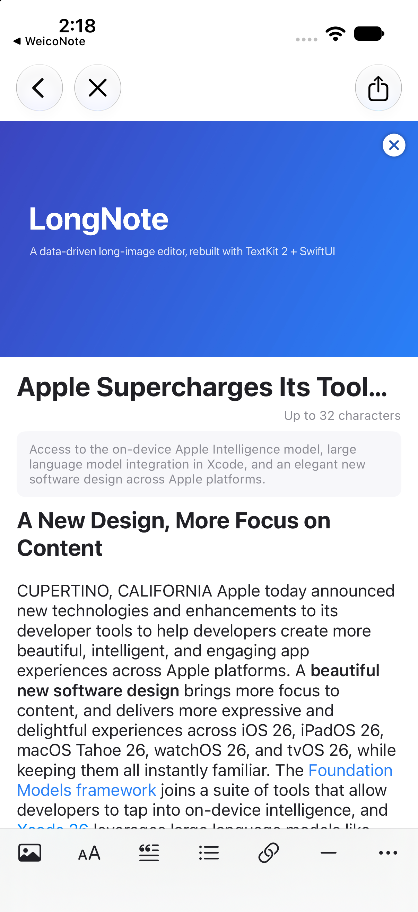
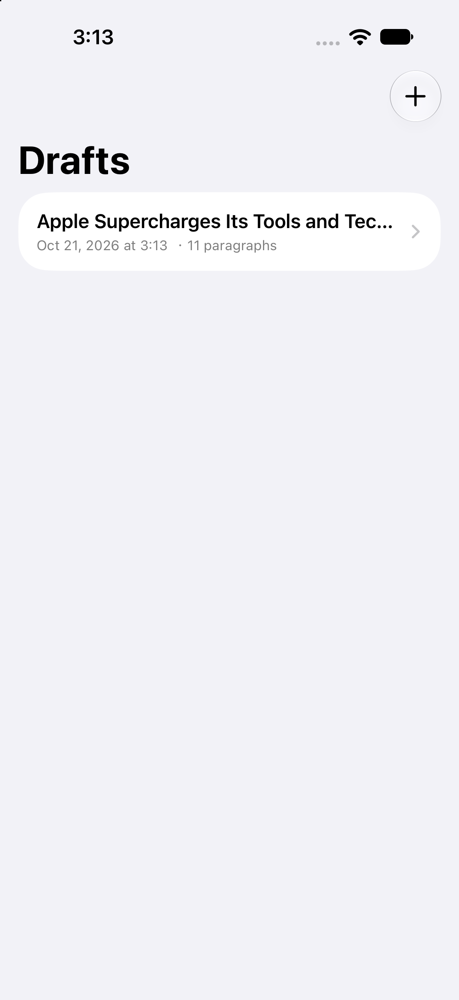

# LongNote

<div align="center">

[](https://github.com/&lt;your-github-username&gt;/LongNote/actions/workflows/ci.yml)
[](LICENSE)


<!-- 使い始める前に <your-github-username> を自分の GitHub ユーザー名に置き換えてください -->
<!-- Before publishing: replace <your-github-username> with your own username -->

</div>

**LongNote** — a pure Swift Package that rebuilds the long-article feature of WeicoNote, a popular Weibo client, as a data-driven rich-text / multimedia card editor, in SwiftUI + TextKit 2, with all networking and platform integration stripped out.

**LongNote** — 微博クライアント「WeicoNote」の長文章機能に由来する、SwiftUI + TextKit 2 でゼロから再構築したデータドリブンなリッチテキスト / マルチメディアカードエディタです。Swift Package として提供し、ネットワーク連携（ログイン・素材・決済・投稿）はすべて除外しています。

## Screenshots / スクリーンショット

<p align="center">
  
  
</p>

*Editor with rich text, mixed block types and autosaved drafts · リッチテキスト・混在ブロック・自動保存される草稿*

---

## 日本語

### LongNote とは

Swift Package Manager で配布できる、長文章（ロングリード）向けのリッチテキスト / マルチメディアカードエディタのコンポーネントライブラリです。微博（Weibo）クライアント「WeicoNote」の長文章機能に発想を得て、SwiftUI と TextKit 2 ですべてゼロから再構築しました。

オリジナルの優れていた部分をそのままに、ネットワークが必要な機能（アカウント、素材ライブラリ、決済、投稿）は意図的に含めていません。本パッケージは純粋に「オフライン編集 + 書き出し」のツールキットです。

### 主な機能

- **段落ごとのリッチテキスト編集** — 各段落が独立した `UITextView`（TextKit 2）。選択範囲単位の太字 / 取り消し線 / 色 / リンクが設定できます。
- **カバー画像・タイトル・リード文** — 16:9 のカバー、32 文字までのタイトル、任意のリード文。
- **混在排版（mixed blocks）** — 大見出し / 小見出し / 本文 / 引用 / リスト / 画像 / 分割線を一つのフロー内に混在させられます。
- **長画像（ロングイメージ）の書き出し** — SwiftUI `ImageRenderer` による描画と、超長文向けのタイル分割フォールバック。
- **草稿の自動保存** — ファイルベースの `ArticleStore`（記事ごとに 1 ディレクトリ）。入力停止 2 秒後に自動保存します。SwiftData への依存はありません。
- **カメラロール保存 / 共有** — Photos・`ShareLink`・`UIActivityViewController` に対応。

### 技術的なアピールポイント

**1. 編集操作をすべて純関数として実装**
Return・行頭 Backspace・複数行ペーストの分割・スタイル変換など、キーボード操作による段落の変化を `[Paragraph] -> ParagraphMutation.Result` の純関数に集約しました。UIKit に一切依存しないため、Linux / Windows を含む任意のプラットフォームで単体テストが実行できます（55 テスト）。

**2. SwiftUI × UITextView 橋渡し時のカーソルジャンプを解消**
段落ごとに `UITextView` を配置し、外部モデルと TextKit 内のテキストが**実際に異なるときだけ**テキストを再設定します。編集結果は delegate 経由で戻すため、双方向バインディングは使いません。行の高さは `layoutManager.usedRect` で計測して SwiftUI 側の行高さに反映しています。

**3. `@FocusState` の制約を `FocusCoordinator` で克服**
`UIViewRepresentable` には `@FocusState` を直接バインドできません。そこでフォーカス中の段落 ID と、分割・結合後のカーソル位置を運ぶコーディネータを実装し、命令的に first responder を操作しています。

**4. リッチテキストのロスレスな永続化**
`CodableAttributedString` はリッチテキストを**セマンティックな run**（テキスト + 太字 / 斜体 / 取り消し線 / 色 / リンク）として保存します。`NSKeyedArchive` の不透明なブロブではなく可読な JSON なので、差分・検索・他言語での読み取りが可能です。v1 のアーカイブ形式も読み込め、次回保存時に v2 へ書き換わります（詳細は `FORMAT.md`）。

**5. 長画像書き出しのメモリ最適化**
数万字の記事を `ImageRenderer` で一度にオフスクリーン描画すると、数万ポイントの高さになりメモリが枯渇します。事前に `sizeThatFits` で計測し、単発描画とタイル分割描画を使い分け、安全なしきい値を超える場合はタイルセットでの共有を促す設計にしました。

**6. クロスプラットフォーム対応のパッケージ設計**
純 Foundation の `LongNoteCore` と UIKit 依存の `LongNote` をターゲット分割し、`#if canImport(UIKit)` で条件コンパイルしています。macOS / iOS でのフルビルドと、Windows / Linux でのコアテストを両立します。

### 動作環境

- Xcode 16 以降（Swift 6 ツールチェーン）
- iOS 18 以降（`@Observable`・TextKit 2・`ImageRenderer`・`PhotosPicker`・`ShareLink` を使用）

`LongNoteCore` ターゲットはプラットフォーム非依存です（モデル・段落変更アルゴリズム・ファイル保存は Foundation のみ）。`swift test` は Windows / Linux / macOS のいずれでも実行できます。

### インストール

Swift Package Manager：

```swift
dependencies: [
    .package(url: "https://github.com/<your-github-username>/LongNote.git", from: "1.0.0"),
]
```

ローカル開発では、このディレクトリを直接参照できます：

```swift
.package(path: "../LongNote")
```

### クイックスタート

```swift
import SwiftUI
import LongNote

struct MyEditorScreen: View {
    @State private var document: ArticleDocument?

    var body: some View {
        if let document {
            ArticleEditorView(document: document, onClose: { dismiss() }) {
                // export a long image
            }
        } else {
            ProgressView().task {
                let store = FileArticleStore()
                let article = Article.empty()   // or store.load(id)
                document = ArticleDocument(article: article, store: store)
            }
        }
    }
}
```

### テスト

```sh
# コアのテストは任意のプラットフォームで実行できます：
swift test --filter LongNoteTests

# Mac では swift build / swift test ですべて（iOS UI を含む）がコンパイルされます。
```

エディタ自体の動作は `LongNoteDemo` を Xcode で実行して確認できます。

### デモアプリ

`Examples/LongNoteDemo/` に最小構成の iOS アプリ（草稿リスト → エディタ → 長画像プレビュー → 保存 / 共有）があります。初回起動時にサンプル記事が自動で読み込まれ、すぐにエディタの全画面を確認できます。Xcode プロジェクトは [XcodeGen](https://github.com/yonaskolb/XcodeGen) で生成します：

```sh
cd Examples/LongNoteDemo
xcodegen generate
open LongNoteDemo.xcodeproj
```

### 設計のポイント

**一段落、一 `UITextView`。** SwiftUI の `TextEditor` は選択範囲の属性制御や選択位置の取得ができません。そこで `UIViewRepresentable`（`RichTextView`）で `UITextView` を橋渡ししています：

- **カーソルジャンプなし** — 外部値と実際の表示が違うときだけテキストを再設定。編集は delegate で戻します。
- **高さの自動追従** — `layoutManager.usedRect` で計測した高さを行の高さとして適用。キャッシュした高さを持ちません。

**編集ルールは純関数。** `ParagraphMutation` はキーボードの操作を `[Paragraph] -> Result` 変換に写像します：

| 操作 | 動作 |
|---|---|
| Return | カーソル位置で分割。後半が新しい段落に（リストは継続） |
| 行頭で Backspace | 前の段落に結合（分割線・画像はスキップ / 削除） |
| 空のリスト項目で Return | リストを解除して本文に変換 |
| 複数行ペースト | 1 行 = 1 段落に分割 |
| 分割線の挿入 | 現在の段落の直後に挿入し、その下の行にカーソルを移す（余分な空行は作らない） |
| 画像の挿入 | 前後に空の本文段落を足してからフォーカスを移動 |

**フォーカス。** `@FocusState` は `UIViewRepresentable` に直接バインドできません。`FocusCoordinator` がフォーカス中の段落 ID を記録し、各テキストビューが first responder になります。分割・結合後はカーソル位置も運びます。

**保存形式。** `FileArticleStore` は以下を書き出します：

```
Documents/Articles/<uuid>/article.json   ← ドキュメント全体（Codable, schemaVersion: 2）
                          images/…        ← ファイル名で参照される画像データ
```

`article.json` のリッチテキストは次のいずれかです（`FORMAT.md` に全仕様）:

```json
"text": { "string": "スタイルなしのテキスト" }
"text": { "runs": [ { "text": "普通の " },
                    { "text": "太字", "bold": true },
                    { "text": "リンク", "link": "https://…" } ] }
```

**長画像のメモリ対策。** `ImageRenderer` は `scale` でオフスクリーン描画します。3 万字の記事は数万ポイントの高さになり、そのままではメモリが爆発します。`ArticleImageRenderer` は (1) `sizeThatFits` で事前計測し、(2) `maxSingleHeight`（既定 5000 pt）に収まる場合は一括描画、(3) 超える場合は `maxTileHeight` のタイルに分割して描画・連結、(4) 連結後も安全なピクセル高を超える場合は `render(_:)` が `nil` を返し、呼び出し側に `renderTiles(_:)` を提示する、という流れです。

### 原案とスコープ

微博「头条文章专业版」（2015 年・iOS 8・Objective-C）の**エディタ中核**、および微博クライアント「WeicoNote」の長文章機能に由来するクリーンルーム実装です。アカウント体系・素材ライブラリ・決済・投稿機能は意図的に移植していません。本パッケージはオフラインの編集・書き出しツールキットであり、MIT ライセンスで提供されます。

---

## English

### What is LongNote

A **pure Swift Package** component library that descends from the long-article feature of WeicoNote, a popular Weibo client, and rebuilds it from scratch in SwiftUI + TextKit 2 — with all networking (login, material library, payment, publishing) stripped out.

You get the parts that made the original editor great:

- **Per-paragraph rich text** — each paragraph is a `UITextView` (TextKit 2), giving full per-run control over bold / strikethrough / color / link, exactly like the original one-paragraph-per-row list.
- **Cover / title / summary** — 16:9 cover, 32-character title, optional lede.
- **Mixed blocks** — H1 / H2 / body / quote / list / image / divider in one flow.
- **Long-image export** — SwiftUI `ImageRenderer` with a tiling fallback for very long articles.
- **Draft autosave** — a tiny file-based `ArticleStore` (one directory per article), autosaved with a 2 s debounce. The library does not bind you to SwiftData.
- **Save to Photos / share** — via Photos / `ShareLink` / `UIActivityViewController`.

### Technical highlights

**1. Editing rules are pure functions.** `ParagraphMutation` maps every keyboard gesture — Return split, backspace-at-start merge, multi-line paste, style conversion, block insertion — to a `[Paragraph] -> Result` transformation. Nothing touches UIKit, so the logic is unit-tested (55 tests) on any platform, including Linux and Windows.

**2. No cursor jumps in the SwiftUI ↔ UITextView bridge.** One `UITextView` per paragraph, bridged through a `UIViewRepresentable` (`RichTextView`). The text is re-set only when the external value actually differs from the text view's content; edits flow back through the delegate, never through two-way binding. Row height comes from `layoutManager.usedRect`, applied as an explicit height — no cached heights.

**3. `@FocusState` can't reach a `UIViewRepresentable` — so a `FocusCoordinator` does.** It records the focused paragraph id, drives first responder per text view, and carries a requested cursor position after splits and merges.

**4. Portable rich-text persistence.** `CodableAttributedString` stores rich text as **semantic runs** — text plus bold / italic / strikethrough / colour / link — instead of an opaque `NSKeyedArchive` blob. The document JSON stays readable, diffable and searchable, and works outside Apple platforms. v1 archives still decode and are rewritten as v2 on the next save (see `FORMAT.md`).

**5. Memory-safe long-image export.** A 30k-character article is tens of thousands of points tall — rendering it whole would exhaust memory. `ArticleImageRenderer` measures first (`sizeThatFits`), renders in one shot when it fits `maxSingleHeight` (default 5000 pt), otherwise renders `maxTileHeight` tiles and stitches them, and returns `nil` when even the stitched image would exceed a safe pixel height so callers can offer `renderTiles(_:)` as a set instead.

**6. Cross-platform package architecture.** `LongNoteCore` (Foundation-only) and `LongNote` (UIKit) are separate targets, with `#if canImport(UIKit)` conditional compilation — full builds on macOS/iOS and core tests on Windows/Linux from one source tree.

### Requirements

- Xcode 16+ (Swift 6 toolchain)
- iOS 18+ (uses `@Observable`, TextKit 2, `ImageRenderer`, `PhotosPicker`, `ShareLink`)

The **core** (`LongNoteCore` target) is platform-independent: models, paragraph mutation algorithms and file storage use only Foundation, so `swift test` runs on Windows / Linux as well as macOS.

### Installation

Swift Package Manager:

```swift
dependencies: [
    .package(url: "https://github.com/<your-github-username>/LongNote.git", from: "1.0.0"),
]
```

For local development, point at this directory:

```swift
.package(path: "../LongNote")
```

### Quick start

```swift
import SwiftUI
import LongNote

struct MyEditorScreen: View {
    @State private var document: ArticleDocument?

    var body: some View {
        if let document {
            ArticleEditorView(document: document, onClose: { dismiss() }) {
                // export a long image
            }
        } else {
            ProgressView().task {
                let store = FileArticleStore()
                let article = Article.empty()   // or store.load(id)
                document = ArticleDocument(article: article, store: store)
            }
        }
    }
}
```

### Export a long image

```swift
let image = await ArticleImageRenderer.render(article) { fileName in
    guard let data = try? store.loadImage(fileName, for: article.id) else { return nil }
    return UIImage(data: data)
}
try? await image?.saveToPhotoLibrary()
```

For very long articles use `ArticleImageRenderer.renderTiles(...)` and share the resulting set — see `Examples/LongNoteDemo/ExportView.swift`.

### Package layout

| Target | Contents | Platforms |
|---|---|---|
| `LongNoteCore` | `Model`, `Mutation` (ParagraphMutation), `Storage`, `TextStyle` | any (Foundation only) |
| `LongNote` | `Editor` (RichTextView bridge, views, toolbars), `Rendering`, `RichText` | iOS 18+ |
| `LongNoteTests` | Unit tests for the core | any |

`LongNote` re-exports `LongNoteCore`, so `import LongNote` brings in the models and store alongside the UI.

```
Sources/
├── LongNoteCore/
│   ├── Model/          ParagraphKind · Paragraph · ParagraphImage · Article · CodableAttributedString
│   ├── Mutation/       ParagraphMutation — split/merge/convert/paste/insert (pure, unit-tested)
│   ├── Storage/        ArticleStore protocol · FileArticleStore
│   └── TextStyle/      font sizes · spacing · RGBA colors (platform-neutral)
└── LongNote/
    ├── Editor/         ArticleDocument (@Observable) · FocusCoordinator · RichTextView ·
    │                   ArticleEditorView · ParagraphEditorView · block views · toolbars
    ├── Rendering/      ArticleRenderView · ArticleImageRenderer (+ tile fallback, photo save)
    └── RichText/       NSAttributedString HTML/AttributedString helpers
```

### Tests

```sh
# macOS / Linux / Windows — the core tests run anywhere:
swift test --filter LongNoteTests
```

On a Mac, `swift build` / `swift test` compile everything (including the iOS UI). The editor itself is exercised by running `LongNoteDemo` in Xcode.

### Demo app

`Examples/LongNoteDemo/` contains a minimal iOS app (draft list → editor → long-image preview → save/share). It seeds a fully-populated sample article on first launch, so the editor can be inspected immediately — and screenshots are representative. Generate its Xcode project with [XcodeGen](https://github.com/yonaskolb/XcodeGen):

```sh
cd Examples/LongNoteDemo
xcodegen generate
open LongNoteDemo.xcodeproj
```

See `Examples/LongNoteDemo/README.md` for details and a no-XcodeGen route.

### Origin & scope

LongNote descends from the long-article feature of WeicoNote, a popular Weibo client (2015, iOS 8, Objective-C), rebuilt from scratch as a modern Swift package. The account system, material library, payment, and publishing features were deliberately **not** ported — this package is purely an offline editing + export toolkit, licensed under the MIT License.
