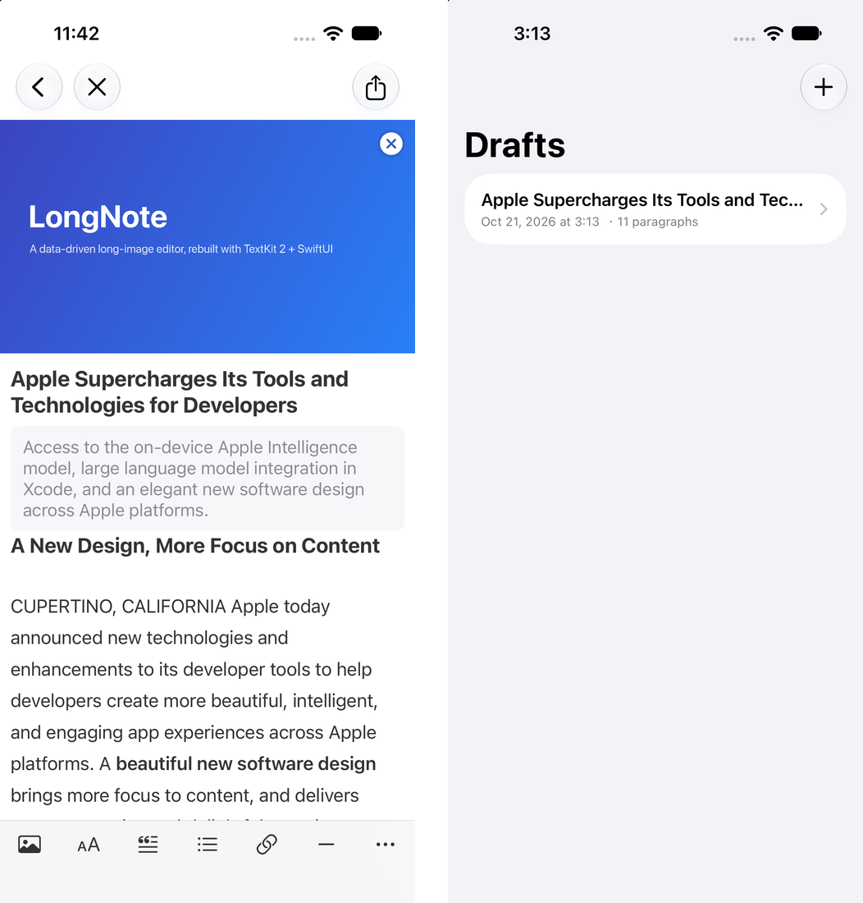

<div align="center">

# LongNote

[简体中文](README.zh-CN.md) | **English** | [日本語](README.ja.md)

[](https://github.com/Bayonetta/LongNote/actions/workflows/ci.yml)
[](LICENSE)


</div>

LongNote is a Swift Package for building offline long-form article editors. It is a from-scratch reimplementation of the former standalone app WeicoNote, which originated from Weibo's Toutiao article feature, using SwiftUI, TextKit 2, and other modern Apple frameworks.



## Features

- **Rich text editing** — paragraph-level formatting with bold, italic, strikethrough, color, and links, backed by TextKit 2.
- **Mixed content blocks** — headings, body text, quotes, lists, images, and dividers in one document.
- **Article metadata** — 16:9 cover image, title limited to 32 characters, and optional summary.
- **Draft autosave** — file-based `ArticleStore` with one directory per article and a 2-second debounce; no SwiftData dependency.
- **Long-image export** — renders an article as one image when possible, then falls back to tiled rendering for very long content.
- **Save and share** — integrates with Photos, `ShareLink`, and `UIActivityViewController`.
- **Readable rich-text storage** — text and formatting are saved as JSON, making drafts easy to inspect and compare.

## Architecture

LongNote is split into a platform-independent core and an iOS UI layer:

| Target | Responsibility |
|---|---|
| `LongNoteCore` | Models, paragraph mutations, storage, and text styles |
| `LongNote` | SwiftUI editor, TextKit 2 bridge, and image rendering |
| `LongNoteTests` | Core unit tests |

The editing rules are pure transformations. Actions such as splitting, merging, pasting, converting styles, and inserting blocks are expressed as `ParagraphMutation` operations and tested without UIKit. `LongNote` re-exports `LongNoteCore`, so applications can use `import LongNote` for both the editor and the data model.

## Requirements

- Xcode 16+
- Swift 6 toolchain
- iOS 18+

`LongNoteCore` only depends on Foundation, so its models, paragraph mutation rules, storage protocol, and file store can be reused across platforms. The `LongNote` target contains the iOS editor UI and depends on SwiftUI, UIKit, and TextKit 2.

## Storage

`FileArticleStore` stores each draft as an independent directory under the app's Documents directory:

```text
Documents/Articles/
└── <article-uuid>/
    ├── article.json
    └── images/
        └── <file-name>
```

For example, a document with a formatted paragraph and an image block is stored like this:

```json
{
  "schemaVersion": 2,
  "id": "A1B2C3D4-...",
  "title": "Apple Supercharges Its Tools and Technologies for Developers",
  "summary": "Access to the on-device Apple Intelligence model, large language model integration in Xcode, and an elegant new software design across Apple platforms.",
  "cover": { "fileName": "cover-<uuid>.jpg", "width": 1600, "height": 900 },
  "createdAt": "2026-11-13T00:00:00Z",
  "updatedAt": "2026-11-13T00:00:00Z",
  "paragraphs": [
    {
      "id": "11111111-...",
      "kind": "title",
      "text": {
        "string": "A New Design, More Focus on Content"
      },
      "image": null,
      "isLastInList": false
    },
    {
      "id": "22222222-...",
      "kind": "body",
      "text": {
        "runs": [
          { "text": "CUPERTINO, CALIFORNIA Apple today announced new technologies and enhancements to its developer tools. A " },
          { "text": "beautiful new software design", "bold": true },
          { "text": " brings more focus to content. The " },
          { "text": "Foundation Models framework", "color": [0.16, 0.50, 0.97, 1] },
          { "text": " joins a suite of tools, and " },
          { "text": "Xcode 26", "link": "https://www.apple.com/newsroom/2025/06/apple-supercharges-its-tools-and-technologies-for-developers/" }
        ]
      },
      "image": null,
      "isLastInList": false
    },
    {
      "id": "33333333-...",
      "kind": "image",
      "text": { "string": "" },
      "image": {
        "fileName": "figure-<uuid>.jpg",
        "width": 1200,
        "height": 800,
        "caption": "Figure — the LongNote editor stack: a platform-neutral core, a TextKit 2 bridge, and a SwiftUI shell."
      },
      "isLastInList": false
    }
  ]
}
```

`article.json` contains metadata, paragraph structure, text formatting, and image references. The actual image bytes are stored as `cover.jpg` and `images/image-01.jpg`; JSON only stores their filenames and dimensions. Text and formatting remain readable in the file, making drafts easy to inspect and compare. The `ArticleStore` protocol keeps the editor independent from the persistence implementation, so an application can provide its own store when needed.

## Installation

Add LongNote with Swift Package Manager:

```swift
dependencies: [
    .package(url: "https://github.com/Bayonetta/LongNote.git", from: "1.0.0")
]
```

For local development:

```swift
.package(path: "../LongNote")
```

## Quick start

```swift
import SwiftUI
import LongNote

struct EditorScreen: View {
    @State private var document: ArticleDocument?

    var body: some View {
        Group {
            if let document {
                ArticleEditorView(document: document, onClose: {})
            } else {
                ProgressView()
            }
        }
        .task {
            let store = FileArticleStore()
            document = ArticleDocument(article: .empty(), store: store)
        }
    }
}
```

## Demo app

`Examples/LongNoteDemo` is a small iOS app showing the draft list, editor, long-image preview, save, and share flows.

```sh
cd Examples/LongNoteDemo
xcodegen generate
open LongNoteDemo.xcodeproj
```

See [`Examples/LongNoteDemo/README.md`](Examples/LongNoteDemo/README.md) for setup details.

## Tests

```sh
swift test --filter LongNoteTests
```

## License

MIT. See [`LICENSE`](LICENSE).
