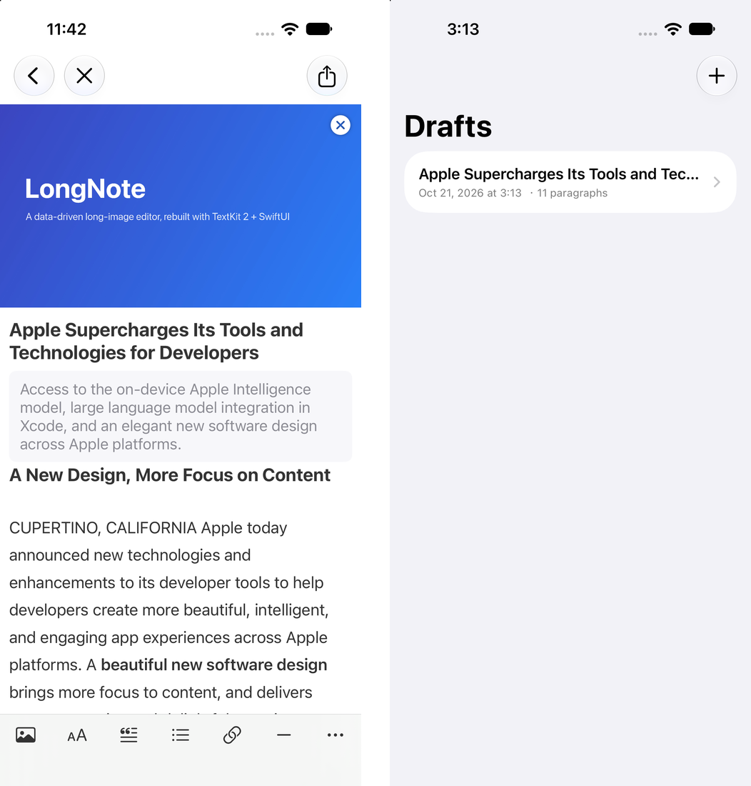

# LongNote

[English](README.md) · [日本語](README.ja.md) · **[中文](README.zh-CN.md)**

[](https://github.com/Bayonetta/LongNote/actions/workflows/ci.yml)
[](LICENSE)


**LongNote** —— 把微博客户端 WeicoNote 的长文章功能，用 SwiftUI + TextKit 2 从零重建为一个数据驱动的富文本 / 多媒体卡片编辑器组件库，去掉全部网络与平台依赖。

## 截图



*富文本、混排块、自动保存的草稿*

## LongNote 是什么

一个可以用 Swift Package Manager 分发的、面向长文章的富文本 / 多媒体卡片编辑器组件库。灵感来自微博客户端 WeicoNote 的长文章功能，用 SwiftUI 与 TextKit 2 全部重写。

原版做对的部分都保留下来；需要联网的部分（账号、素材库、支付、投稿）刻意没有移植。这个包只做「离线编辑 + 导出」。

## 主要功能

- **逐段富文本编辑** —— 每个段落是一个独立的 `UITextView`（TextKit 2），可以按选区设置加粗 / 删除线 / 颜色 / 链接，与「一段一行」的原版一致。
- **封面 / 标题 / 导语** —— 16:9 封面、标题输入到 32 字即停止、可选导语。
- **混排块** —— 大标题 / 小标题 / 正文 / 引用 / 列表 / 图片 / 分割线可自由混排。
- **长图导出** —— SwiftUI `ImageRenderer` 渲染，超长文章走分片兜底。
- **草稿自动保存** —— 基于文件的 `ArticleStore`（一篇文章一个目录），停止输入 2 秒后自动保存，不绑定 SwiftData。
- **保存到相册 / 分享** —— 支持 Photos、`ShareLink`、`UIActivityViewController`。

## 技术亮点

**1. 编辑规则全部是纯函数。** `ParagraphMutation` 把回车分段、行首退格合并、多行粘贴拆分、样式转换、块插入等所有键盘操作映射为 `[Paragraph] -> Result` 变换。完全不碰 UIKit，因此可以在任意平台跑单测（55 个），包括 Linux 与 Windows。

**2. SwiftUI 与 UITextView 桥接不跳光标。** 每个段落一个 `UITextView`，通过 `UIViewRepresentable`（`RichTextView`）桥接。只有外部值与文本视图内容**真正不一致**时才重设文本；编辑结果通过 delegate 回传，不使用双向绑定。行高由 `layoutManager.usedRect` 测量后显式应用，不缓存高度。

**3. `@FocusState` 管不到 `UIViewRepresentable`，于是有了 `FocusCoordinator`。** 它记录当前聚焦的段落 ID，逐个驱动 first responder，并在分段、合并后携带光标位置。

**4. 可移植的富文本持久化。** `CodableAttributedString` 把富文本存成**语义 run**（文本 + 加粗 / 斜体 / 删除线 / 颜色 / 链接），而不是不透明的 `NSKeyedArchive` blob。文档 JSON 可读、可 diff、可搜索，在 Apple 平台之外也能解析。v1 的 archive 仍能读取，下次保存时自动写成 v2（详见 [`FORMAT.md`](FORMAT.md)）。

**5. 长图导出的内存优化。** 3 万字的文章有几万点高，一次性离屏渲染会耗尽内存。`ArticleImageRenderer` 先测量（`sizeThatFits`），能塞进 `maxSingleHeight`（默认 5000 pt）就一次渲染，否则按 `maxTileHeight` 分片渲染再拼接；如果拼接后仍超过安全像素高度，`render(_:)` 返回 `nil`，提示调用方改用 `renderTiles(_:)` 拿一组切片。

**6. 跨平台的包结构。** `LongNoteCore`（纯 Foundation）与 `LongNote`（依赖 UIKit）拆成两个 target，用 `#if canImport(UIKit)` 条件编译 —— 同一份源码，macOS/iOS 全量构建，Windows/Linux 跑核心测试。

## 环境要求

- Xcode 16 及以上（Swift 6 工具链）
- iOS 18 及以上（用到 `@Observable`、TextKit 2、`ImageRenderer`、`PhotosPicker`、`ShareLink`）

**核心层**（`LongNoteCore` target）与平台无关：模型、段落变更算法、文件存储只用 Foundation，所以 `swift test` 在 Windows / Linux / macOS 都能跑。

## 安装

Swift Package Manager：

```swift
dependencies: [
    .package(url: "https://github.com/YOUR_GITHUB_USERNAME/LongNote.git", from: "1.0.0"),
]
```

本地开发可直接指向这个目录：

```swift
.package(path: "../LongNote")
```

## 快速开始

```swift
import SwiftUI
import LongNote

struct MyEditorScreen: View {
    @State private var document: ArticleDocument?

    var body: some View {
        if let document {
            ArticleEditorView(document: document, onClose: { dismiss() }) {
                // export a long image
            }
        } else {
            ProgressView().task {
                let store = FileArticleStore()
                let article = Article.empty()   // or store.load(id)
                document = ArticleDocument(article: article, store: store)
            }
        }
    }
}
```

## 导出长图

```swift
let image = await ArticleImageRenderer.render(article) { fileName in
    guard let data = try? store.loadImage(fileName, for: article.id) else { return nil }
    return UIImage(data: data)
}
try? await image?.saveToPhotoLibrary()
```

超长文章请用 `ArticleImageRenderer.renderTiles(...)` 并分享返回的切片集合 —— 见 `Examples/LongNoteDemo/ExportView.swift`。

## 包结构

| Target | 内容 | 平台 |
|---|---|---|
| `LongNoteCore` | `Model` / `Mutation`（ParagraphMutation）/ `Storage` / `TextStyle` | 任意（仅 Foundation） |
| `LongNote` | `Editor`（RichTextView 桥接、视图、工具栏）/ `Rendering` / `RichText` | iOS 18+ |
| `LongNoteTests` | 核心层单测 | 任意 |

`LongNote` 会重新导出 `LongNoteCore`，所以 `import LongNote` 就能同时拿到模型、存储和 UI。

```
Sources/
├── LongNoteCore/
│   ├── Model/          ParagraphKind · Paragraph · ParagraphImage · Article ·
│   │                   CodableAttributedString · TextRun · PlatformRichText
│   ├── Mutation/       ParagraphMutation —— 分段 / 合并 / 转换 / 粘贴 / 插入（纯函数，有单测）
│   ├── Storage/        ArticleStore 协议 · FileArticleStore
│   └── TextStyle/      字号 · 间距 · RGBA 颜色（与平台无关）
└── LongNote/
    ├── Editor/         ArticleDocument (@Observable) · FocusCoordinator · RichTextView ·
    │                   ArticleEditorView · ParagraphEditorView · 各块视图 · 工具栏
    ├── Rendering/      ArticleRenderView · ArticleImageRenderer（分片兜底） · LongImagePreview（捏合 / 双击缩放）
    └── RichText/       NSAttributedString / HTML / AttributedString 辅助
```

## 测试

```sh
# macOS / Linux / Windows —— 核心测试在任何平台都能跑：
swift test --filter LongNoteTests
```

在 Mac 上 `swift build` / `swift test` 会连 iOS UI 一起编译。编辑器本身的交互用 Xcode 跑 `LongNoteDemo` 验证。

## 示例 App

`Examples/LongNoteDemo/` 是一个最小 iOS App（草稿列表 → 编辑器 → 长图预览 → 保存 / 分享）。首次启动会自动载入一篇完整示例文章，打开就能看到编辑器的全貌。Xcode 工程用 [XcodeGen](https://github.com/yonaskolb/XcodeGen) 生成：

```sh
cd Examples/LongNoteDemo
xcodegen generate
open LongNoteDemo.xcodeproj
```

详细说明与「不用 XcodeGen」的手动步骤见 `Examples/LongNoteDemo/README.md`。

## 存储格式

一篇草稿是一个目录：一个 JSON 文档加图片文件。富文本存成语义 run，因此文件可读、可移植：

```json
"text": { "runs": [ { "text": "A paragraph with " },
                    { "text": "bold", "bold": true },
                    { "text": " and a " },
                    { "text": "link", "link": "https://example.com" } ] }
```

完整字段、v1 兼容规则与迁移步骤都在 [`FORMAT.md`](FORMAT.md)。

## 设计要点

**一段一个 `UITextView`。** SwiftUI 的 `TextEditor` 无法按选区控制属性、也拿不到选区位置，所以用 `UIViewRepresentable`（`RichTextView`）桥接：

- **不跳光标** —— 只有外部值与实际显示不一致时才重设文本；编辑通过 delegate 回传。
- **高度自动跟随** —— 用 `layoutManager.usedRect` 测量的高度作为行高，不缓存。

**编辑规则是纯函数。** `ParagraphMutation` 把键盘操作映射为 `[Paragraph] -> Result`：

| 操作 | 行为 |
|---|---|
| 回车 | 在光标处分段，后半段成为新段落（列表延续） |
| 行首退格 | 合并进上一段（跳过 / 删除分割线与图片） |
| 空列表项回车 | 取消列表，转回正文 |
| 多行粘贴 | 一行拆成一个段落 |
| 插入分割线 | 直接插在当前段落下方，光标落到分割线下一行（不产生多余空行） |
| 插入图片 | 前后各补一个空正文段落，再移动焦点 |

**焦点。** `@FocusState` 不能直接绑定到 `UIViewRepresentable`，`FocusCoordinator` 记录聚焦段落 ID，各文本视图自己成为 first responder，分段合并后还会携带光标位置。

**长图的内存对策。** `ImageRenderer` 通过 `scale` 做离屏渲染，3 万字文章会有几万点高，直接渲染会爆内存。`ArticleImageRenderer` 的流程是：(1) 用 `sizeThatFits` 预测量；(2) 能塞进 `maxSingleHeight`（默认 5000 pt）就整张渲染；(3) 超出就按 `maxTileHeight` 分片渲染再拼接；(4) 拼接后仍超过安全像素高度时 `render(_:)` 返回 `nil`，让调用方改用 `renderTiles(_:)`。

## 项目来源与范围

源自微博「头条文章专业版」（2015 年、iOS 8、Objective-C）的**编辑器内核**，以及微博客户端 WeicoNote 的长文章功能，用现代 Swift 重新实现。账号体系、素材库、支付与投稿功能刻意没有移植 —— 这个包只是离线的编辑 + 导出工具包，采用 MIT 协议。
