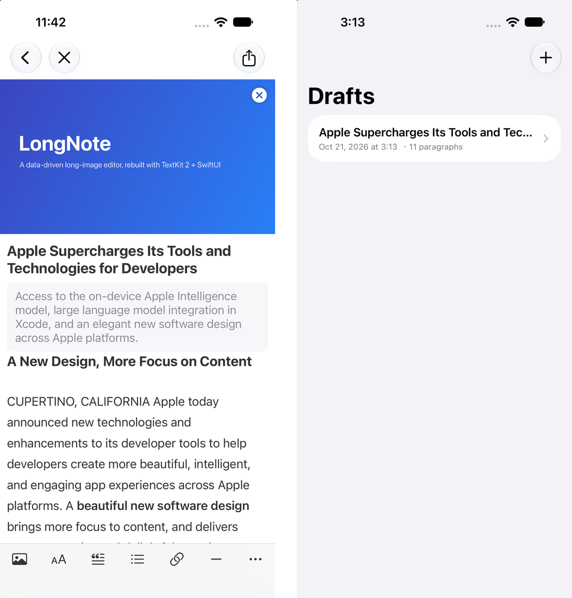

<div align="center">

# LongNote

**简体中文** | [English](README.md) | [日本語](README.ja.md)

[](https://github.com/Bayonetta/LongNote/actions/workflows/ci.yml)
[](LICENSE)


</div>

LongNote 是一个用于构建离线长文编辑器的 Swift Package。项目基于曾经的独立 App WeicoNote（由微博的头条文章功能剥离而来）重新开发，使用 SwiftUI、TextKit 2 等现代 Apple 技术实现。



## 核心功能

- **富文本编辑**：基于 TextKit 2，支持段落级加粗、斜体、删除线、颜色和链接。
- **混合内容块**：标题、正文、引用、列表、图片和分割线可以在同一篇文章中自由排列。
- **文章信息**：16:9 封面图、最多 32 个字符的标题，以及可选摘要。
- **草稿自动保存**：基于文件的 `ArticleStore`，一篇文章对应一个目录，输入停止 2 秒后自动保存，不依赖 SwiftData。
- **长图导出**：内容较短时一次渲染，超长文章自动切片渲染，避免一次性占用过多内存。
- **保存与分享**：支持保存到 Photos、`ShareLink` 和 `UIActivityViewController`。
- **可读的富文本存储**：文字和格式保存为 JSON，方便查看和比较修改内容。

## 项目结构

LongNote 分为与平台无关的核心层和 iOS 界面层：

| Target | 职责 |
|---|---|
| `LongNoteCore` | 数据模型、段落变换、存储和文本样式 |
| `LongNote` | SwiftUI 编辑器、TextKit 2 桥接和图片渲染 |
| `LongNoteTests` | 核心层单元测试 |

编辑规则由纯函数实现。分段、合并、粘贴、样式转换和插入内容块等操作都通过 `ParagraphMutation` 表达，可以脱离 UIKit 单独测试。`LongNote` 会重新导出 `LongNoteCore`，应用只需 `import LongNote` 即可同时使用编辑器和数据模型。

## 环境要求

- Xcode 16+
- Swift 6 工具链
- iOS 18+

`LongNoteCore` 只依赖 Foundation，其中的数据模型、段落变换规则、存储协议和文件存储可以跨平台复用。`LongNote` target 包含 iOS 编辑器界面，依赖 SwiftUI、UIKit 和 TextKit 2。

## 存储结构

`FileArticleStore` 会在 App 的 Documents 目录下为每篇草稿创建独立目录：

```text
Documents/Articles/
└── <article-uuid>/
    ├── article.json
    └── images/
        └── <file-name>
```

例如，一篇包含格式化文本和图片块的文章会保存成下面这样：

```json
{
  "schemaVersion": 2,
  "id": "A1B2C3D4-...",
  "title": "Apple Supercharges Its Tools and Technologies for Developers",
  "summary": "Access to the on-device Apple Intelligence model, large language model integration in Xcode, and an elegant new software design across Apple platforms.",
  "cover": { "fileName": "cover-<uuid>.jpg", "width": 1600, "height": 900 },
  "createdAt": "2026-11-13T00:00:00Z",
  "updatedAt": "2026-11-13T00:00:00Z",
  "paragraphs": [
    {
      "id": "11111111-...",
      "kind": "title",
      "text": {
        "string": "A New Design, More Focus on Content"
      },
      "image": null,
      "isLastInList": false
    },
    {
      "id": "22222222-...",
      "kind": "body",
      "text": {
        "runs": [
          { "text": "CUPERTINO, CALIFORNIA Apple today announced new technologies and enhancements to its developer tools. A " },
          { "text": "beautiful new software design", "bold": true },
          { "text": " brings more focus to content. The " },
          { "text": "Foundation Models framework", "color": [0.16, 0.50, 0.97, 1] },
          { "text": " joins a suite of tools, and " },
          { "text": "Xcode 26", "link": "https://www.apple.com/newsroom/2025/06/apple-supercharges-its-tools-and-technologies-for-developers/" }
        ]
      },
      "image": null,
      "isLastInList": false
    },
    {
      "id": "33333333-...",
      "kind": "image",
      "text": { "string": "" },
      "image": {
        "fileName": "figure-<uuid>.jpg",
        "width": 1200,
        "height": 800,
        "caption": "Figure — the LongNote editor stack: a platform-neutral core, a TextKit 2 bridge, and a SwiftUI shell."
      },
      "isLastInList": false
    }
  ]
}
```

`article.json` 保存文章信息、段落结构、文字格式和图片引用。实际图片数据保存为 `cover.jpg` 和 `images/image-01.jpg`，JSON 只记录文件名和尺寸。文字和格式都以可读的 JSON 保存，方便查看、迁移和比较修改内容。`ArticleStore` 协议让编辑器与具体持久化实现解耦，宿主应用也可以替换自己的存储方式。

## 安装

使用 Swift Package Manager：

```swift
dependencies: [
    .package(url: "https://github.com/Bayonetta/LongNote.git", from: "1.0.0")
]
```

本地开发：

```swift
.package(path: "../LongNote")
```

## 快速开始

```swift
import SwiftUI
import LongNote

struct EditorScreen: View {
    @State private var document: ArticleDocument?

    var body: some View {
        Group {
            if let document {
                ArticleEditorView(document: document, onClose: {})
            } else {
                ProgressView()
            }
        }
        .task {
            let store = FileArticleStore()
            document = ArticleDocument(article: .empty(), store: store)
        }
    }
}
```

## 示例 App

`Examples/LongNoteDemo` 是一个最小 iOS 示例，展示草稿列表、编辑器、长图预览、保存和分享流程。

```sh
cd Examples/LongNoteDemo
xcodegen generate
open LongNoteDemo.xcodeproj
```

详细步骤见 [`Examples/LongNoteDemo/README.md`](Examples/LongNoteDemo/README.md)。

## 测试

```sh
swift test --filter LongNoteTests
```

## 许可证

MIT，详见 [`LICENSE`](LICENSE)。
